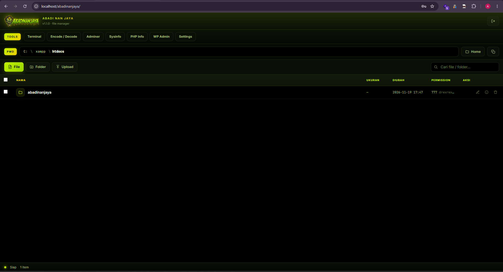
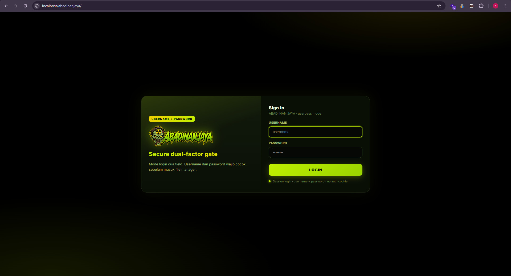
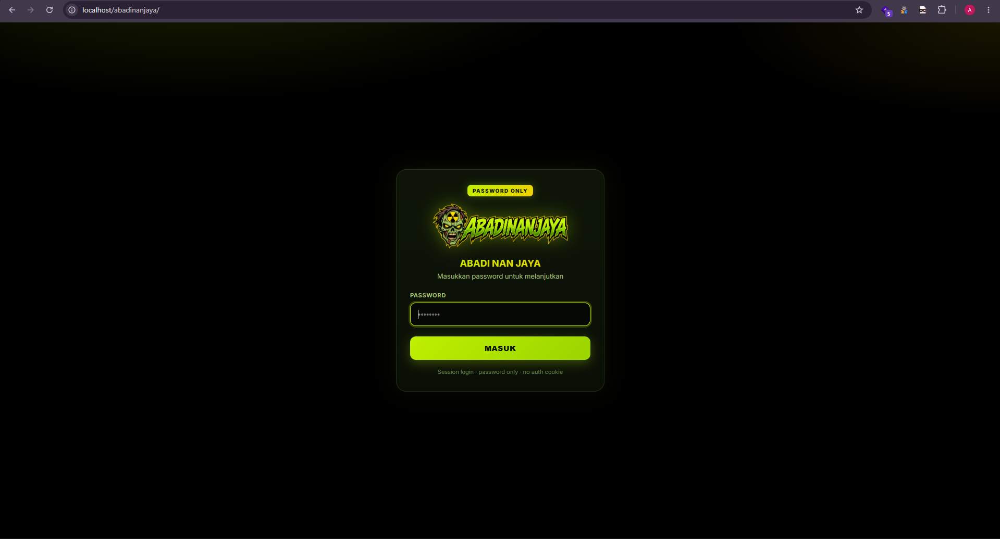

<p align="center">
  
</p>

<h1 align="center">ABADI NAN JAYA</h1>
<p align="center">
  <b>Single-file PHP File Manager</b><br/>
  Dark toxic-green UI · multi-auth · tools · WordPress helper · LiteSpeed loader
</p>

<p align="center">
  
  
  
  
</p>

---

## Preview

### File Manager
<p align="center">
  
</p>

### Login — Username + Password
<p align="center">
  
</p>

### Login — Password only
<p align="center">
  
</p>

### Brand
<p align="center">
  
</p>

---

## Features

| Module | Description |
|--------|-------------|
| **File Manager** | Browse, upload, download, edit, rename, move, copy, delete, chmod |
| **PWD bar** | Clickable path segments — jump folders fast |
| **Terminal** | Shell via PHP functions (`proc_open` → `exec` …) with `disable_functions` fallback |
| **Encode / Decode** | Base64, URL, HTML, Hex, MD5/SHA, JSON, ROT13 |
| **Adminer** | Auto-download Adminer and open DB UI |
| **Sysinfo / PHP Info** | Server & PHP diagnostics |
| **WP Admin** | Scan `DOCUMENT_ROOT` for `wp-config.php`, create admin user, auto-login form |
| **Settings** | Switch auth mode (saved into `index.php`) |
| **LiteSpeed loader** | `abadi_litespeed.php` — remote fetch + cache, multi fallback HTTP |

---

## Requirements

- PHP **5.6+** (7.4+ recommended)
- Apache / Nginx / LiteSpeed / any PHP host
- Optional: **PDO MySQL** (WordPress Admin & SQL tools)
- Optional: `curl` / `allow_url_fopen` (Adminer, remote loader)

Works on **Windows · Linux · macOS**.

---

## Install

### A) Full app (`index.php`)

1. Upload **`index.php`** to your web directory  
2. Open it in the browser  
3. Login with defaults below (or edit config at top of `index.php`)

```text
your-domain.com/index.php
# or
your-domain.com/abadinanjaya/
```

### B) LiteSpeed / thin loader (`abadi_litespeed.php`)

1. Upload **`abadi_litespeed.php`** only  
2. Open it — pulls latest `index.php` from GitHub raw  
3. Optional: `?refresh=1` or `?nocache=1` to force re-fetch  

```text
your-domain.com/abadi_litespeed.php
```

Cache is **outside webroot** only (never next to the loader):

| Priority | Path |
|----------|------|
| 1 | `/dev/shm/abadi_data/` (RAM) |
| 2 | `/tmp/abadi_data/` |
| 3 | `sys_get_temp_dir()/abadi_data/` (Windows / fallback) |

TTL default **300** seconds. Old `.abadi_ls_cache.php` in the site folder is auto-deleted if present.

---

## Default login

| Field | Value |
|-------|-------|
| **Mode** | `userpass` (Username + Password) |
| **Username** | `abadinanjaya` |
| **Password** | `abadinanjayateam` |

> Password is stored as **MD5** inside `index.php`. Type the plain password when logging in.

### Other auth modes

Edit near the top of `index.php`:

```php
define('FM_AUTH_MODE', 'userpass'); // none | cookie | password | userpass
define('FM_AUTH_USER', 'abadinanjaya');
define('FM_AUTH_PASS', '...');      // MD5 for password/userpass
define('FM_COOKIE_NAME', 'abadinanjaya');
define('FM_COOKIE_VALUE', 'abadinanjayateam');
```

| Mode | Behavior | Preview |
|------|----------|---------|
| `none` | Open access — no login page | — |
| `cookie` | Pure host **404** until cookie is set | — |
| `password` | Password-only login (session) | `priview_p.png` |
| `userpass` | Username + password (session) | `priview_u_p.png` |

Or use **Tools → Settings** (writes defines back into `index.php`).

---

## Tools quick guide

1. **Terminal** — run commands in current folder  
2. **Encode / Decode** — text transforms & hashes  
3. **Adminer** — auto install + redirect to `adminer.php`  
4. **Sysinfo / PHP Info** — environment  
5. **WP Admin** — find WordPress under `DOCUMENT_ROOT`, create administrator  
6. **Settings** — auth mode & credentials  

---

## Security notes

- Change default username/password after install  
- Use HTTPS in production  
- Restrict access by IP / basic auth if exposed publicly  
- **Authorized use only** — do not use on systems you do not own  

---

## Project layout

```text
AbadiNanJaya/
├── index.php              # full application (single file)
├── abadi_litespeed.php    # thin remote loader + cache (LiteSpeed-friendly)
├── icon.png               # brand logo
├── priview.png            # screenshot — file manager
├── priview_p.png          # screenshot — password login
├── priview_u_p.png        # screenshot — username + password login
├── README.md
└── .gitignore
```

---

## Links

- Repo: https://github.com/BlackNovaHub/AbadiNanJaya  
- Raw `index.php`: https://raw.githubusercontent.com/BlackNovaHub/AbadiNanJaya/main/index.php  
- Icon: https://raw.githubusercontent.com/BlackNovaHub/AbadiNanJaya/main/icon.png  

---

<p align="center">
  <b>ABADI NAN JAYA</b> · BlackNovaHub
</p>
